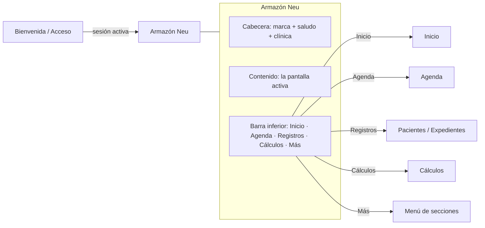

# Mapa de la app (línea Neu)

Cómo está repartida VetDosis: qué apartados hay, por dónde se entra y se sale
de cada uno, y qué se ve dentro. La fuente es el código de la línea vigente
(`lib/core/app.dart` despacha las pantallas; `lib/modules/core/domain/section_catalog.dart`
declara los grupos del menú).

## 1. Armazón: por dónde se entra y se sale

Todo lo que hay tras iniciar sesión vive en un armazón con tres entradas fijas.

- **Entrada a la app:** pantalla de bienvenida / acceso. Con sesión activa se
  entra al armazón. Sin sesión, la bienvenida pública.
- **Salida de cualquier pantalla:** la cabecera (marca, saludo, clínica) lleva a
  cuenta; la barra inferior cambia de rama sin volver atrás.
- **Cinco ramas fijas** en la barra inferior: Inicio, Agenda, Registros,
  Cálculos y Más.

## 2. Los grupos de apartados (menú "Más" y "Cálculos")

Los grupos no conceden permisos: solo ordenan el menú. Si el rol no autoriza
una página, no aparece.

| Grupo | Apartados |
|---|---|
| Atención y expedientes | Agenda · Pacientes · Hospitalización · Receta · Formatos |
| Medicamentos y herramientas | Cálculo rápido · Vademécum · Operaciones de dosis · Cálculos clínicos · Inventario · Escanear producto |
| Producción animal | Producción y grandes especies (bovinos, porcinos, aves…) |
| Exóticos y silvestres | Exóticos |
| Administración y finanzas | Caja · Planeación financiera · Servicios · Proveedores · Promociones · Productividad y semana |
| Equipo y comunicación | Agenda telefónica · Equipo y avisos · Anuncios y avisos · Pendientes del equipo · Checado |
| Estadísticas y reportes | Estadísticas |
| Asistente IA | Asistente IA |
| Revisión de catálogos | Modo revisión |
| Cuenta y ajustes | Mi cuenta y clínicas · Ajustes · Respaldo · Planes · Producto y costos · Inicio guiado · Ayuda y soporte |

## 3. Pantalla por pantalla: ruta → widget → entradas y salidas

Cada fila es una pantalla del despachador real. "Entra desde" es el origen de
navegación; "sale hacia" es lo que ofrece dentro.

| Apartado (ruta) | Widget | Entra desde | Qué ofrece / sale hacia |
|---|---|---|---|
| Inicio | (vista `home()`) | Barra inferior | Cuadrícula de accesos directos, buscador, avisos. Sale a cualquier apartado de un toque. |
| Más | `SectionMenu` | Barra inferior | Grupos de arriba con buscador. Sale a cada apartado autorizado. |
| Cálculos | `CalculationMenu` | Barra inferior | Menú clínico. Sale a Cálculo rápido, Vademécum, Operaciones de dosis, Cálculos clínicos. |
| Producción y grandes especies | `ProductionMenu` | Grupo Producción | Menú por especie. Sale a las calculadoras de producción (por cabeza y lote, agua y alimento). |
| Exóticos | `ExoticsMenu` | Grupo Exóticos | Catálogo de exóticos y la calculadora de peso metabólico; respeta permiso. |
| Cálculo rápido | `DoseScreen` | Cálculos / Inicio | Dosis por paciente. Sale a elegir paciente o escanear etiqueta. |
| Escanear etiqueta para dosis | `DoseLabelScannerScreen` | Cálculo rápido | Lee etiqueta y devuelve datos al cálculo. |
| Vademécum | `VademecumScreen` | Cálculos / Inicio | Consulta de medicamentos. |
| Operaciones de dosis | `DoseMathTools` | Cálculos / Inicio | Regla de tres y herramientas de dosis. |
| Cálculos clínicos | `CalculationScreen` (rama clínica) | Cálculos / Inicio | Calculadoras clínicas (fluidoterapia, CRI, ajuste de dosis, protocolos, constantes y retiros). |
| Pacientes | `PatientsScreen` | Barra (Registros) / Atención | Expedientes. Sale a receta, formatos, hospitalización. |
| Hospitalización | `HospitalScreen` | Grupo Atención | Cuidados diarios, peso, altas, envíos. |
| Receta | `PrescribingScreen` | Grupo Atención / Paciente | Emisión de recetas; usa firma y plantillas. |
| Formatos | `FormsScreen` | Grupo Atención | Consentimientos y formatos; abre el editor de documentos. |
| Escanear producto | `QuickScanScreen` | Grupo Medicamentos | Alta rápida de inventario por código. |
| Inventario / Caja | `InventoryScreen` | Grupo Medicamentos / Finanzas | Inventario y ventas; `initialSection` decide si abre en Caja. |
| Agenda | `OperationsScreen` | Barra inferior | Agenda, equipo, avisos, pendientes, servicios, proveedores comparten host. |
| Agenda telefónica | `ContactDirectoryScreen` | Grupo Equipo | Directorio de contactos. |
| Equipo y avisos | `OperationsScreen` (`messages`) | Grupo Equipo | Mensajes internos del equipo; misma pantalla que la Agenda. |
| Anuncios y avisos | `OperationsScreen` (`notices`) | Grupo Equipo | Avisos publicados al equipo. |
| Pendientes del equipo | `OperationsScreen` (`tasks`) | Grupo Equipo | Tareas pendientes y su seguimiento. |
| Servicios | `OperationsScreen` (`services`) | Grupo Finanzas | Catálogo de servicios y precios; sale a la Agenda. |
| Proveedores | `OperationsScreen` (`suppliers`) | Grupo Finanzas | Proveedores y sus datos de contacto. |
| Planeación financiera | `FinancialPlanningPanel` | Grupo Finanzas | Proyección de ingresos y costos; solo administrador. |
| Productividad y semana | `ProductivityScreen` | Grupo Finanzas | Plan semanal y tareas. |
| Promociones | `PromotionsScreen` | Grupo Finanzas | Promociones y clientes; genera imagen de oferta. |
| Checado | `AttendanceScreen` | Grupo Equipo | Registro de asistencia del equipo. |
| Estadísticas | `DashboardScreen` | Grupo Estadísticas / Barra | Tableros y gráficas. |
| Respaldo | `BackupScreen` | Grupo Cuenta | Copias y restauración. |
| Asistente IA | `AiScreen` | Grupo Asistente IA | Chat con contexto configurable. |
| Planes | `SubscriptionScreen` | Grupo Cuenta / guía | Planes y suscripción. |
| Producto y costos | `ProductScreen` | Grupo Cuenta | Funciones y límites antes de datos reales. |
| Inicio guiado | `GuidedStartScreen` | Grupo Cuenta / aviso inicial | Guía por pasos. |
| Ayuda y soporte | `SupportScreen` | Grupo Cuenta | Reportar problemas y seguir soporte. |
| Ajustes | `settings()` | Grupo Cuenta / cabecera | Paleta, apariencia clara/oscura, estilo Neu. |
| Mi cuenta y clínicas | `AuthScreen` (cuenta) | Cabecera | Espacio personal o clínica del equipo; roles desde la cuenta. |
| Modo revisión | `ReviewCatalogScreen` | Grupo Revisión | Catálogos con datos sin verificar; comenta errores por fila. |
| Bienvenida pública | `PublicWelcomeScreen` | Sin sesión | Entrada a la app antes de autenticar. |

Notas de acceso:

- **Requieren rol MVZ o administrador:** Cálculo rápido, Escanear etiqueta,
  Operaciones de dosis, Cálculos clínicos.
- **Modo revisión** requiere cuenta autorizada y conexión (lo usa la beta de
  profesores para revisar datos sin validar).
- **Cuenta de plataforma:** sin segundo factor no muestra herramientas
  administrativas.

## 4. Inicio guiado: los pasos

`GuidedStartScreen` (`lib/modules/welcome/presentation/guided_start_screen.dart`)
lleva a cada apartado en orden. Marcar un paso indica que se revisó; no cambia
permisos.

1. Usa tu espacio personal o la clínica del equipo → **Mi cuenta**
2. Elige paleta y apariencia → **Ajustes**
3. Explora funciones y límites → **Producto y costos**
4. Captura tus datos profesionales y revisa membrete → **Receta**
5. Captura datos con consentimiento y revisa el expediente → **Pacientes**
6. Decide qué contexto comparte la IA → **Planes**
7. Reporta problemas y sigue el soporte → **Ayuda y soporte**

El paso 1 no cambia de pantalla: abre la cuenta como ventana encima de la guía
(`openAccount`). Los otros seis sí cambian el apartado activo. Verificado en el
armazón real pulsando el botón «Abrir» de cada tarjeta
(`test/inicio_guiado_test.dart`, 7 casos). El progreso se guarda por usuario y
clínica; el aviso inicial (`FirstStepsBanner`) se descarta con «Más tarde» y no
vuelve a salir para ese ámbito.

## 5. Distribución visual y tipografía

- **Marca y color:** Plus Jakarta Sans empaquetada; paletas de la app; el
  elemento neumórfico (`NeuStatTile`, `AccessBackdrop`, `VetIcons`) da la
  identidad Neu.
- **Escala tipográfica:** vive en `VetTheme.textTheme`. Tamaños
  `12 · 14 · 16 · 22 · 24 · 26 · 30` (más `labelSmall` en 11). El tema fija los
  tamaños base, pero **37 textos de interfaz todavía declaran su `fontSize` a
  mano** (los que más: `promotion_image_screen.dart` 7,
  `branded_export_action.dart` 5, `calculator_surface.dart` 5). Unificarlos
  queda pendiente. Los tamaños del PDF se miden aparte, en milímetros de papel.

## 6. Cómo se comprueba todo esto

- `flutter build web --release` compila la app.
- `flutter test test/previews/capture_*.dart` escribe PNG por pantalla en
  `review/` (solo lectura).

Este mapa se revisó contra `beta/profesores-20261115` (`ee5f409`): las clases de
la sección 3, los grupos de la sección 2 y los 7 pasos del Inicio guiado existen
en esa rama. Lo que no existe en beta y por eso no se cita: el guardián
`test/typography_guard_test.dart`, `test/inicio_guiado_test.dart`,
`test/mapa_de_la_app_test.dart` y `scripts/validation/check_diseno_vigente.py`.
Viven en `fix/tipografia-neu`.
