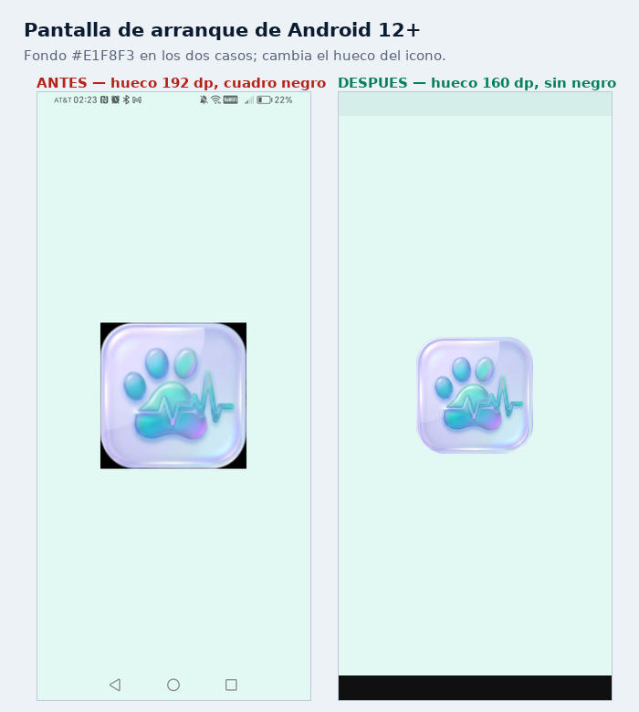

# Arranque de Android: el cuadro negro detrás del logo

## Qué se veía

Al abrir la app, la marca aparecía muy grande y encerrada en un cuadro negro,
sobre el verde muy claro del arranque.

## Por qué pasaba

Medí la captura del teléfono (720×1600 px, densidad 2.0) y el cuadro negro
resultó ser un cuadrado exacto de **191 dp centrado**. Ese número es la pista:
no era un recorte del arte ni un PNG sin transparencia —comprobé los 15 PNG del
icono y todos conservan su canal alfa con las esquinas en `(0,0,0,0)`.

Android 12+ dibuja el icono de arranque en un hueco de **192 dp cuando no se
declara `windowSplashScreenIconBackgroundColor`**, y lo baja a **160 dp cuando
sí se declara**. Nuestros dos `styles.xml` no lo declaraban, así que pasaban las
dos cosas a la vez:

1. El icono se dibujaba en el hueco grande de 192 dp → se veía desproporcionado.
2. Al no haber color de respaldo, la transparencia del icono se componía sobre
   negro → el cuadro oscuro.

Viene del commit `0bdfd95`, que corrigió el icono equivocado (apuntaba al vector
jubilado `vetdosis_app_icon`) pero cambió a un icono adaptativo con fondo
transparente sin añadir el respaldo que ese tipo de icono necesita.

## Qué cambié

En `values-v31/styles.xml` y `values-night-v31/styles.xml`, una línea en cada
uno, con el mismo tono que ya usa el fondo del arranque:

| Archivo | Fondo del arranque | Respaldo del icono (nuevo) |
| --- | --- | --- |
| `values-v31` (claro) | `#E1F8F3` | `#E1F8F3` |
| `values-night-v31` (oscuro) | `#201F25` | `#201F25` |

Al coincidir ambos tonos el respaldo es invisible: no se ve ningún cuadro, y el
logo queda en 160 dp en vez de 192 dp.

> La simulación del «después» está compuesta a partir del arte real y de las
> medidas de la API; la confirmación final es ver el APK en el teléfono.

## Protección añadida

`test/android_splash_icon_test.dart` gana un caso que exige que
`windowSplashScreenIconBackgroundColor` **exista y sea igual** a
`windowSplashScreenBackground` en los dos `styles.xml`. Si alguien cambia el
tono del arranque y olvida el respaldo, la prueba falla y el cuadro negro no
puede volver a colarse. Los casos que ya existían siguen pasando: no toqué el
icono (`@mipmap/vetdosis_launcher`) ni el adaptativo transparente.

## Un detalle sobre el verde claro

El `#E1F8F3` del arranque es el primer tono del degradado de marca que fijó
`dc01a73`. Android 12+ **solo admite un color sólido** en el fondo del arranque,
no un degradado, así que ahí no se puede replicar el degradado completo; el
degradado sí aparece en cuanto el arranque cede el paso a la app. Si prefieres
que ese primer instante sea de otro tono, es cambiar los dos valores de la tabla
(los dos del mismo archivo, para que la prueba siga pasando).

## Pendiente de tu lado

Nada de Android se puede compilar en este entorno. Queda por validar:

- `flutter test test/android_splash_icon_test.dart`
- Instalar el APK y abrir la app en claro y en oscuro.
